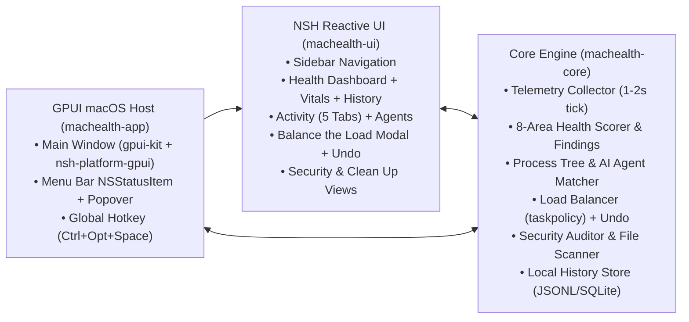

# MacHealth — Product Design, Features List & Implementation Plan

> **Location:** `apps/machealth/` (standalone Rust workspace)  
> **Target Platform:** macOS 14+ (Apple Silicon & Intel)  
> **Tech Stack:** Rust (2024 edition) · **GPUI** (`gpui-fast` / `gpui-kit`) · **NSH** (Native Shell: `nsh-core`, `nsh-base`, `nsh-platform-gpui`) · **macOS Native APIs** (`objc2-app-kit`, `libc`/Mach/sysctl, IOKit, `pmset`, `taskpolicy`, `mdfind`)

---

## 1. Product Vision & Core Principles

Modeled on [Brello for Mac](https://brello.ai), **MacHealth** is a lightweight, local-first macOS health monitor, plain-English task manager, load balancer, and disk cleaner in one native app:

1. **Plain English over raw jargon** — Every reading translates system numbers into human verdicts (*"The chip is running cool"*, *"Apps have the memory they need"*, *"Light / Moderate / Heavy"*).
2. **Actionable, not just observational** — Every health finding pairs with a single button to fix it or open the exact macOS System Settings pane.
3. **Asks first, never breaks macOS** — Quit, Force Quit, Balance the Load, and Clean Up always prompt with the exact target name. Critical macOS system processes, other users' processes, and MacHealth itself are protected and refused with a clear reason.
4. **Zero admin password, zero cloud, zero AI bloat** — Uses only public macOS interfaces and built-in tools. All history stays locally in `~/Library/Application Support/MacHealth/`.
5. **Featherweight footprint** — GPU-accelerated GPUI rendering via NSH, low idle CPU (~1% of one core), and fast startup.

---

## 2. Complete Features List

### A. Health Dashboard & 8-Area Score (0–100)
- **Health Score (0–100)** computed from 8 weighted areas:
  1. **Processor & Heat** (CPU load + macOS thermal state)
  2. **Memory & Swap** (RAM pressure, compressed memory, swap usage)
  3. **Storage & Drive Wear** (Available space as Finder counts it, SSD SMART wear where readable)
  4. **Battery** (Max capacity %, cycle count, temperature — or desktop wall-power state)
  5. **Sleep & Wake** (Active `pmset` sleep-prevention assertions + sleep/display timers)
  6. **Stability** (Recent crash reports in `~/Library/Logs/DiagnosticReports`)
  7. **Startup Items** (LaunchAgents & Login Items count/bloat)
  8. **Security, Updates & Backups** (FileVault, Firewall, Gatekeeper, Time Machine, macOS updates)
- **Plain-Words Verdict** (e.g., *"Good — 3 things need your attention"*) with expandable **Findings** list and a 1-click **Fix / Inspect** button per finding.
- **Live Vitals Cards ("Right Now")**:
  - **CPU**: % usage, core breakdown (Performance vs Efficiency cores on Apple Silicon).
  - **Heat**: Thermal state in plain words (`Normal`, `Warm`, `Hot`, `Very Hot`) + battery temperature on laptops.
  - **Memory**: Used / Total GB, Apps, Kept by macOS (Wired), Compressed, Swap, and Memory Pressure level.
  - **Storage**: Available / Total GB (including purgeable space, matching Finder).
  - **Network**: Live Down/Up throughput (KB/s, MB/s).
  - **Sleep**: Which app is keeping the Mac awake, reason, duration, and configured sleep/display timers.
- **Using the Most**: Top 5 apps grouped with their helpers, switchable by **Processor / Memory / Energy / Disk**.
- **History (Hour / Day / Week / Month)**: Local time-series graphs for CPU and Memory usage with plain-English summary (*"Processor 10% on average, briefly up to 96%. Busiest: Xcode, Chrome."*).

### B. Activity — Intelligent Task Manager
- **5 Core Tabs** matching Activity Monitor: **CPU**, **Memory**, **Energy**, **Disk**, **Network**.
- **App + Helper Grouping**: Automatically rolls up helper processes (e.g., Chrome Renderer, Electron Helpers, XPC services) under their parent application, with expand/collapse.
- **Plain-English Labels**: Every app/process tagged as **Light**, **Moderate**, or **Heavy**, plus a short human-readable description of what common macOS/app processes do.
- **Safe Actions**: **Quit** (`SIGTERM` / AppleEvent) and **Force Quit** (`SIGKILL`) with confirmation dialog and safety guardrails (refuses PID 0/1, `launchd`, `WindowServer`, root/other-user processes, and MacHealth itself).

### C. Agents Tab — AI Agent Monitor
- Dedicated view tracking local AI apps and coding agents (e.g., Claude, ChatGPT, Cursor, Codex, Ollama, LM Studio, Antigravity, MCP servers, local Python/Node agent workers).
- Groups each agent with **every child process it spawned** (process-tree attribution) and displays its combined CPU, Memory, and Energy share.
- Supports safe **End Session / Quit** with confirmation.

### D. Balance the Load (with Before/After & Undo)
- Scans for heavy background CPU hogs and long-idle memory-heavy apps.
- Shows a clear preview of what will be changed and asks for confirmation.
- **Action**: Shifts heavy background processes to Apple Silicon Efficiency cores using macOS QoS / `taskpolicy -b -p <pid>` (no admin password needed for user-owned processes), and optionally quits selected idle apps.
- **Measured Before & After**: Captures CPU/thermal/memory readings before and after applying, displaying the delta.
- **Undo**: Stores an in-memory + persisted undo ledger to restore throttled processes back to normal scheduling (`taskpolicy -B -p <pid>`).

### E. Security & Maintenance Audits
- Live non-privileged checks for:
  - **FileVault** (`fdesetup status`)
  - **Firewall** (`/usr/libexec/ApplicationFirewall/socketfilterfw --getglobalstate`)
  - **Gatekeeper** (`spctl --status`)
  - **Time Machine** (`tmutil latestbackup` / destination check)
  - **macOS Software Updates** (local update status check)
  - **Login / Startup Items** (`~/Library/LaunchAgents`)
- Each item shows pass/warn status in plain words and a button that opens the relevant macOS System Settings pane (`x-apple.systempreferences:...`).

### F. Home (Files by Kind) & Clean Up
- **Home**: Categorizes user files by kind (Documents, Images, Videos, Audio, Archives, Apps/Installers, Developer/Code, Other) with file count and total size.
- **Clean Up**: Finds safe-to-review clutter:
  - Old installers (`.dmg`, `.pkg` in `~/Downloads`)
  - Forgotten large downloads (older than 30 days)
  - Safe user app caches (`~/Library/Caches` safe entries)
  - Xcode DerivedData / Trash size summary
- **Asks First**: Lists every file with path and size before anything is touched; moves selected items to **macOS Trash** (recoverable) rather than permanent deletion.

### G. Menu Bar Panel & Quick Search
- Native macOS **Menu Bar Item** (`NSStatusItem`) showing the live Health Score badge.
- Opens via click or global shortcut **`Control-Option-Space`**.
- Compact popover with: Health score, live CPU/Memory/Heat vitals, top 3 busy apps, quick "Balance the Load" trigger, and **Quick Search** (instant Spotlight/`mdfind` file search with click-to-open/reveal in Finder).

---

## 3. Product Design & Architecture



### Visual Direction
- **Native macOS Aesthetic**: Clean light & dark theme following system appearance, crisp hairline borders, subtle elevated cards, tabular numerals for live percentages/sizes, semantic status colors (Green = Good, Amber = Attention, Red = Heavy/Hot).
- **Navigation Shell**:
  - Left sidebar: **Health**, **Activity**, **Agents**, **Security**, **Home & Clean Up**
  - Top bar: Health Score pill, plain-English verdict, and prominent **Balance the Load** button (plus **Undo** chip when a balance action is active).

### Workspace Layout

```text
apps/machealth/
├── Cargo.toml                  # Standalone Rust workspace (edition 2024)
├── README.md                   # Overview, build/run instructions, status
├── PRODUCT_DESIGN.md           # This document
├── AGENT_WORKLOG.md            # Ongoing engineering context & verification log
├── .gitignore                  # target/, .DS_Store, etc.
└── crates/
    ├── machealth-core/         # Pure Rust telemetry, scoring, actions, storage
    │   └── src/
    │       ├── lib.rs
    │       ├── telemetry/      # CPU (P/E cores), Memory/Swap, Thermal, Disk, Net, Battery, Sleep
    │       ├── processes/      # Process list, parent+helper grouping, 5-tab metrics, safe Quit
    │       ├── agents/         # AI agent detection & child-process tree attribution
    │       ├── scoring/        # 8-area Health Score (0-100), verdict, actionable findings
    │       ├── balancer/       # Balance the Load (taskpolicy -b/-B), before/after, Undo ledger
    │       ├── security/       # FileVault, Firewall, Gatekeeper, Time Machine, Updates, Login Items
    │       ├── cleanup/        # Home files-by-kind & safe Clean Up scanner (Trash-based)
    │       ├── search/         # Quick Search via macOS Spotlight (mdfind)
    │       └── history/        # Local persistent telemetry history (Hour/Day/Week/Month)
    ├── machealth-ui/           # NSH (nsh-core + nsh-base) views & reactive components
    │   └── src/
    │       ├── lib.rs
    │       ├── state.rs        # Reactive app state bridged from machealth-core
    │       ├── theme.rs        # Light/Dark semantic tokens & typography
    │       ├── components/     # ScoreGauge, VitalCard, Sparkline/HistoryChart, ConfirmDialog
    │       └── views/          # health, activity, agents, balancer, security, cleanup, menubar
    └── machealth-app/          # macOS GPUI host (gpui-fast + nsh-platform-gpui + objc2)
        └── src/
            ├── main.rs         # GPUI application bootstrap & main window
            ├── menubar.rs      # NSStatusItem + Menu Bar panel + Ctrl-Opt-Space hotkey
            └── platform.rs     # macOS System Settings deep links, Reveal in Finder, Trash
```

---

## 4. Phased Implementation Plan

| Phase | Scope | Verification |
|---|---|---|
| **Phase 1: Foundation & Telemetry Core** | Set up Cargo workspace with `machealth-core`, implement real macOS telemetry collectors (CPU P/E cores, Memory/Swap/Pressure, Thermal state, Disk, Network, Battery, Sleep assertions) + 8-area Health Score engine + unit tests. | `cargo test -p machealth-core` passes with real macOS readings verified. |
| **Phase 2: Process Tree, AI Agents & Load Balancer** | Implement process enumeration & parent+helper grouping, 5-tab metrics (CPU/Memory/Energy/Disk/Network), plain-English labels, safe Quit/Force Quit guardrails, AI Agent tree detector, and Balance the Load (`taskpolicy`) with before/after capture and Undo. | Unit & integration tests for grouping, guardrails, and balancer state machine. |
| **Phase 3: Security Audits, Home/Clean Up, History & Quick Search** | Implement FileVault/Firewall/Gatekeeper/Time Machine/Updates/Startup checks, Home file-kind categorizer, safe Clean Up scanner (move to Trash), local History ring/store (Hour/Day/Week/Month), and Spotlight Quick Search. | `cargo test -p machealth-core` covering all auditors, scanners, and history aggregation. |
| **Phase 4: NSH + GPUI Desktop UI** | Build `machealth-ui` using NSH (`nsh-core`, `nsh-base`) and embed it in `machealth-app` via `nsh-platform-gpui` + `gpui-fast` / `gpui-kit`. Wire all 5 views (Health, Activity, Agents, Security, Home & Clean Up) with live polling and confirmation modals. | `cargo build` succeeds and launches native macOS GPUI window cleanly. |
| **Phase 5: Menu Bar Panel, Quick Search & Polish** | Add `objc2-app-kit` `NSStatusItem` menu bar panel, `Control-Option-Space` shortcut, System Settings deep links, and polish. | Full build, tests, and live smoke-run verification on macOS. |

---

## 5. Key Technical Notes

- **NSH + GPUI Integration**: Reference `nsh-core`, `nsh-base`, and `nsh-platform-gpui` as Cargo dependencies paired with `gpui-fast` / `gpui-kit` so standard `cargo build` and `cargo run` work without requiring a separate global CLI installation.
- **No Admin Password**: Every collector and action uses standard unprivileged macOS APIs (`sysctl`, `host_statistics64`, `proc_pidinfo`, `pmset`, `ioreg`, `fdesetup`, `socketfilterfw`, `spctl`, `tmutil`, `taskpolicy`, `mdfind`).
- **Scope**: Focused on **Brello for Mac** core capabilities (Health, Activity, Agents Monitor, Balance the Load, Security, Home & Clean Up, Menu Bar + Quick Search) with zero AI model bloat.
