# Pramana

A menu-bar Activity Monitor for Mac. It lists apps, not processes. Each app gets one figure for memory, CPU, energy, disk, and network, with every helper already added in.

Status: spec only. Nothing is built yet.

## Name

**Pramana** (प्रमाण). Sanskrit for a measure, and for the standard you know something by. Working name.

## Reference

The images in `docs/references/` are captures of [vitalsmac.com](https://vitalsmac.com/) on 26 September 2026. The figures on that page are simulated. They are the visual target for Pramana's window, menu bar, and the smaller features around them.

Pramana is a local app. The reference product's store, license keys, pricing, and refunds are not part of this product.

## The job

Activity Monitor answers "what is this process doing right now?" On a working Mac that is about a thousand rows, and a hundred of them are named Google Chrome Helper.

Pramana answers "which app?" One row, one figure. It also keeps what happened while you were not looking, and it says when an app is misbehaving.

Against Activity Monitor, that is the whole difference: about 60 apps instead of about 1,000 processes, one figure with the helpers included, 30 days of history, an alert when an app misbehaves, a menu-bar item, dev servers grouped by project, temperatures and fans, and a volume slider per app.

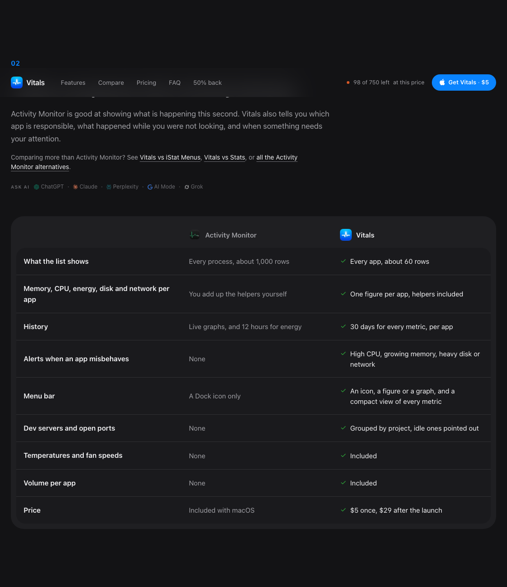

## Where it lives

Three surfaces.

1. A main window, with a tab per subsystem.
2. A menu-bar item. Clicking it opens a pocket version of the same window. One more click opens the main window on the same tab.
3. A notification, only when an app has been misbehaving for a while.

The Dock icon is off by default and can be turned on. The menu-bar item stays either way.

## How it looks

Dark window. Traffic-light controls. A pill of tabs across the top: Overview, CPU, Memory, Disk, Network, GPU, Battery, Projects.

Each subsystem has one color, used for its label, its chart, and its bars.

| Tab | Color |
|-----|--------|
| CPU | Blue |
| Memory | Purple |
| Disk | Amber |
| Network | Green |
| GPU | Pink |
| Battery | Green |
| Projects | Orange |

A tab is a big figure, a chart, a row of small stats, and a list of apps. An app row is an icon, the name, how many processes are inside it, a bar, and the number. Rows sort by the number on that tab.

## One row per app

Every helper is added to the app that launched it. Chrome Helper, Code Helper, and Safari Web Content disappear into Chrome, Visual Studio Code, and Safari. The row says how many processes are inside.

A process that is not part of an app stays as its own row, under its own name: `kernel_task`, WindowServer, and the other system processes people actually look up.

Opening a row shows the processes inside it: name, pid, and that process's share of the figure. Closing it goes back to one line.

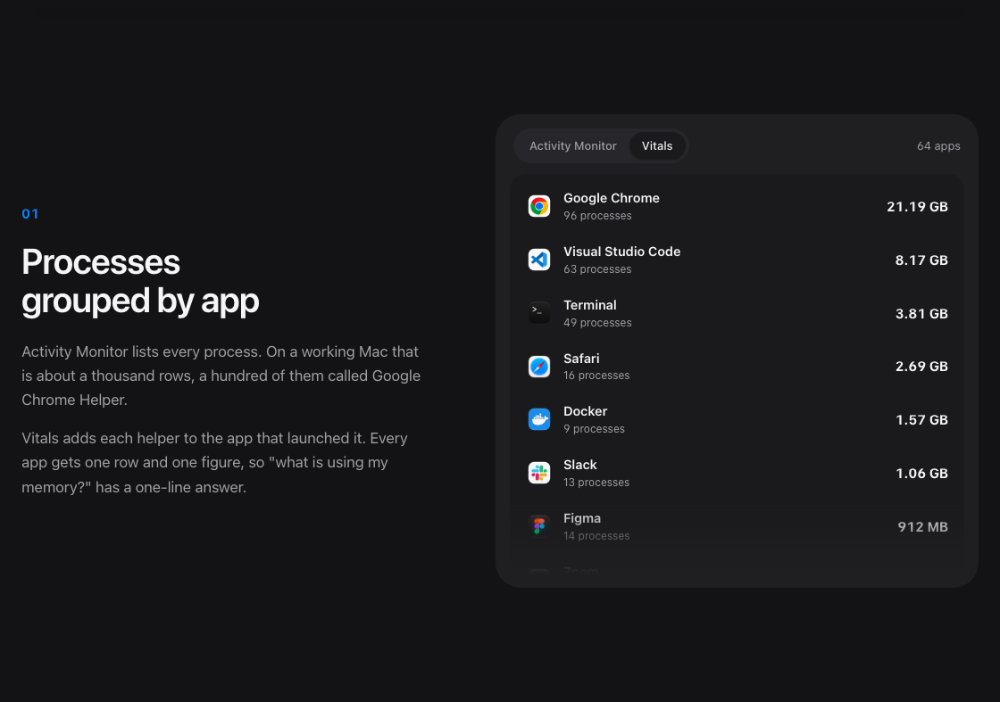

## Main window

### Overview

Six cards, one per subsystem, plus three breakdowns. A card opens that tab.

Each card shows the live figure, two or three supporting numbers, and a short history strip.

Under the cards:

- **Memory by type.** A ring of App, Wired, Compressed, Cached, and Free, with the share in use in the middle.
- **Memory by app.** The same ring, split by app, plus Other.
- **Power by app.** Watts, split the same way.

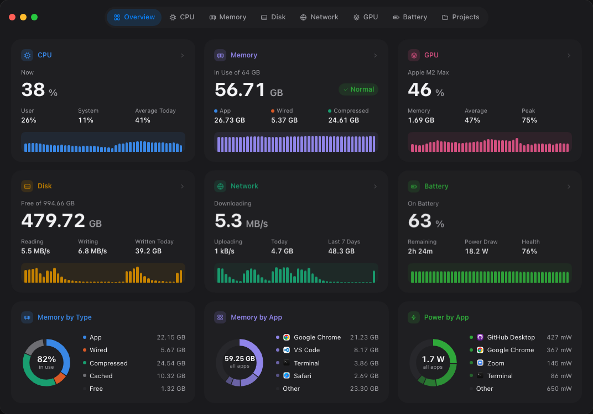

### CPU

- Now, as a percent, with an area chart.
- Average today, and load.
- User (your apps) and System (macOS).
- Core count, split into performance and efficiency cores on Apple silicon.
- Top app, then the full list by CPU.

A setting chooses whether 100% means one core or the whole Mac. The window says which one is in use.

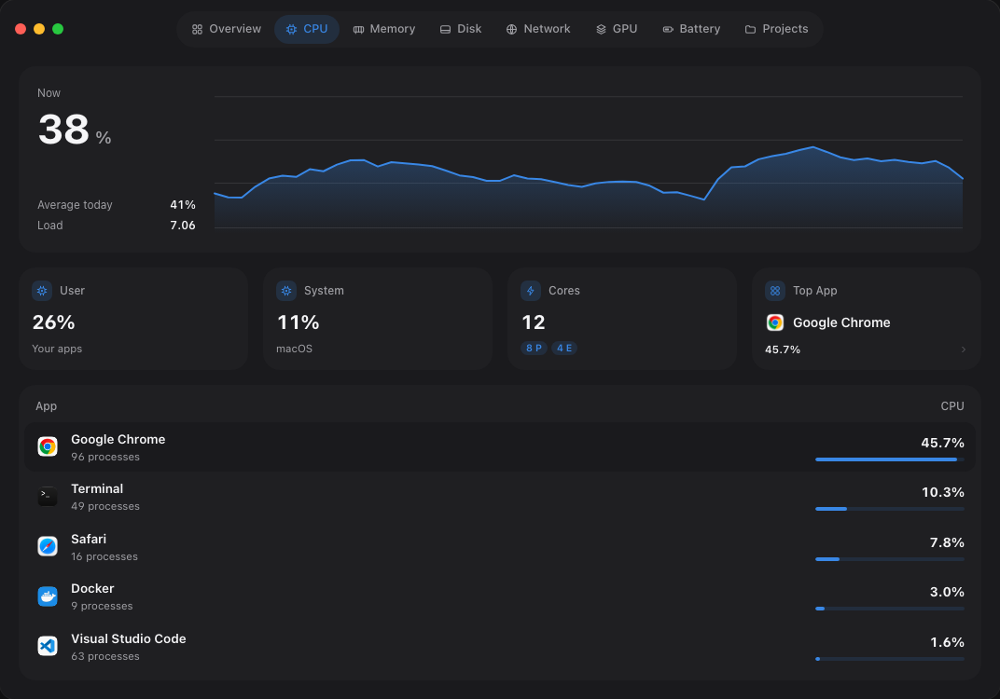

### Memory

- In use, of the installed total, with a pressure label: Normal, Warning, or Critical.
- Free, and swap used.
- App, Wired, and Compressed, each with its share of the total.
- Top app, then the list by memory.

The figure is the process footprint, so compressed memory counts.

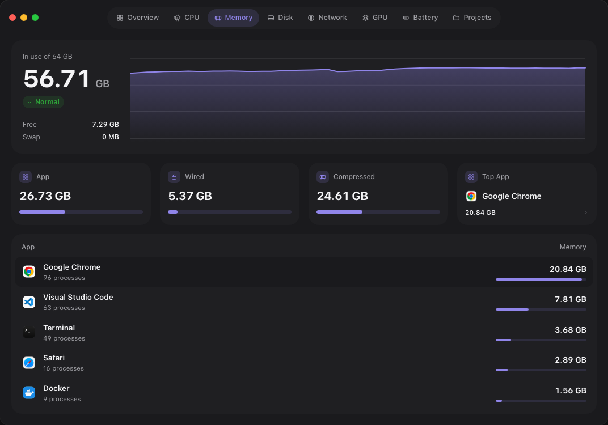

### Disk

- Free space, of the total, with an area chart of the recent rate.
- Used, and written today.
- Reading and writing, right now.
- Volumes, by name.
- Top app by writes, then the list.

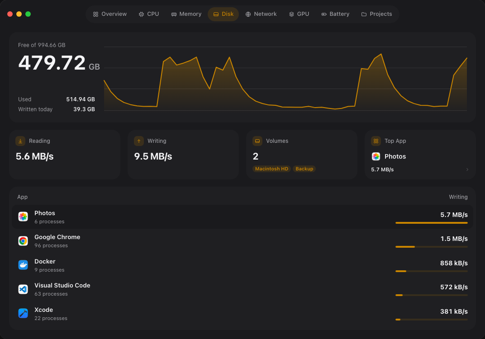

### Network

- Downloading, with an area chart.
- Uploading.
- Today, the last 7 days, and the last 30 days. These totals must not jump after the Mac sleeps.
- The active interface, by name (`Wi-Fi`, `en0`).
- Top app by download, then the list.

A setting chooses bytes or bits per second.

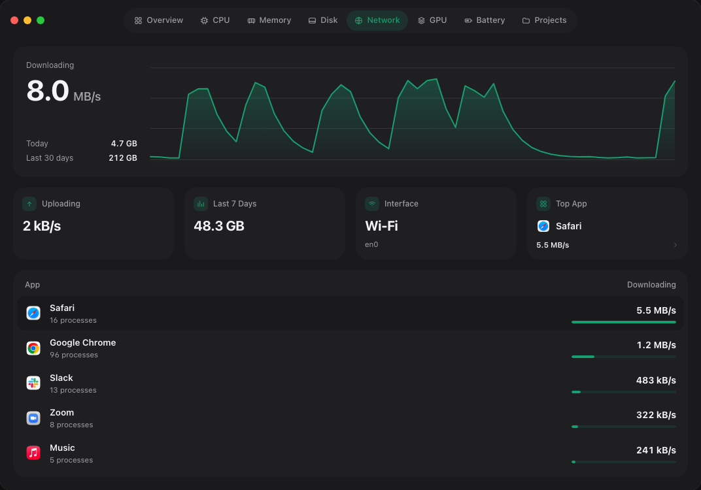

### GPU

- The GPU's name, utilization, and an area chart.
- Average and peak for the session.
- GPU memory in use.
- Top app, then the list.

Power and temperature are most detailed on Apple silicon. On a Mac where the GPU figure is unavailable, the tab says so instead of showing a zero.

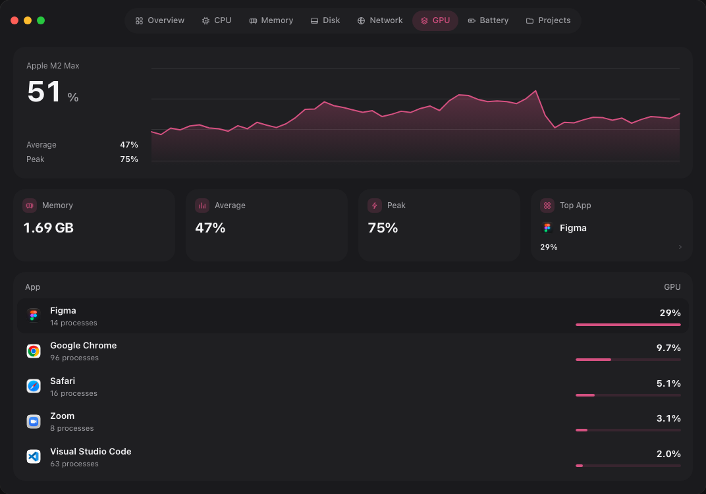

### Battery

Hidden on a Mac with no battery.

- Charge, on battery or charging, and time remaining.
- Cycle count, power draw, health (maximum capacity), and temperature.
- Top app by power, then the list in watts.

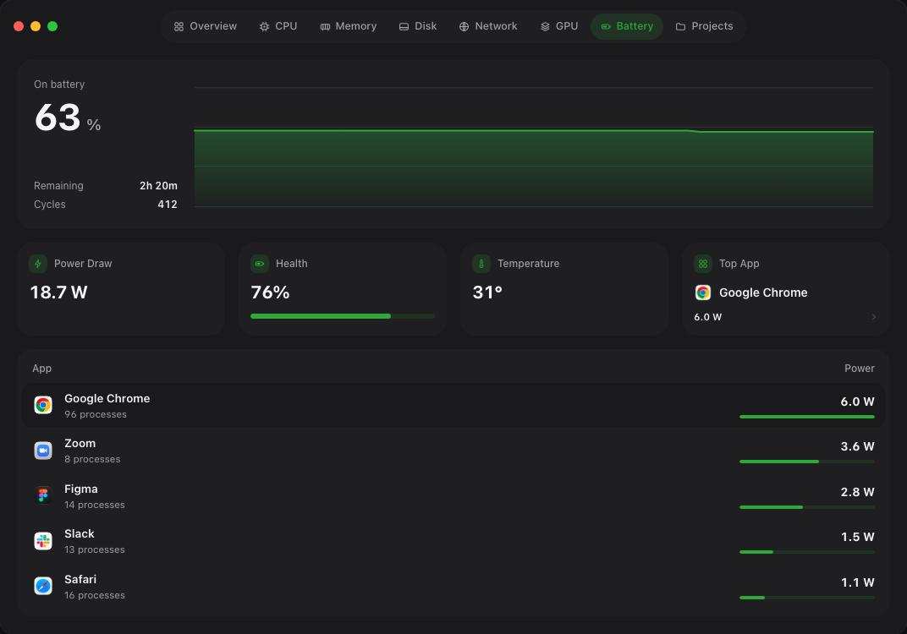

## Projects

Processes grouped by the project folder they were started in. A project is the nearest parent directory that holds a `package.json`, `pyproject.toml`, `go.mod`, `Cargo.toml`, `Package.swift`, or an Xcode project.

Each row shows the runtime (`node`, `python`, `go`), the ports it is listening on, memory, and a plain status: working, or idle for how long. Ports wrap. A port that macOS handed to a helper is not listed as a dev server.

An idle server is one that has used almost no CPU for a long stretch, including one left up for days. The top of the tab says how many are idle, how much memory they hold, and which ports they have. **Stop all** asks before it stops them, and the confirmation names the memory and the ports.

Stopping one server offers Quit, and Force Quit if it does not quit. Quitting a whole project says what it will stop and which ports it frees. A Terminal tab that is merely open in that folder stays open.

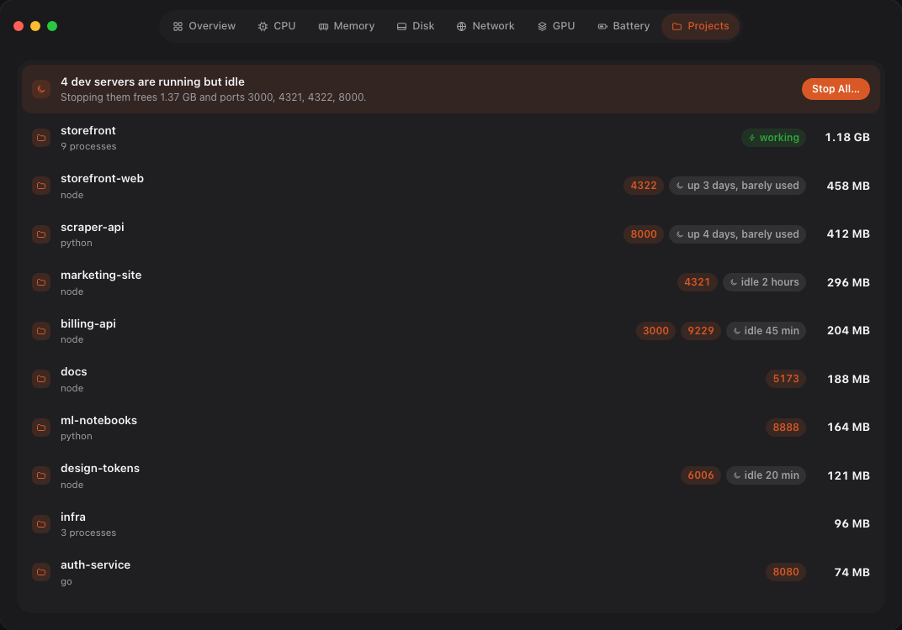

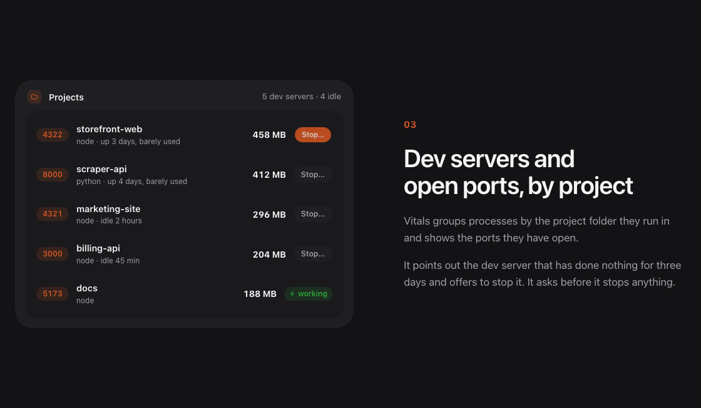

## Menu bar

The item is one of four shapes. You pick the shape, and which metrics it shows: CPU, memory, GPU, network, temperature, battery.

| Shape | What you see | Reference |
|-------|----------------|-----------|
| Icon | A small mark. It becomes a warning when the Mac is under strain. | 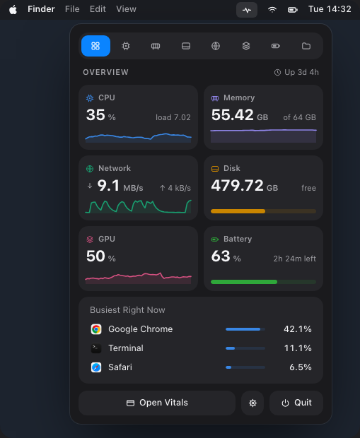 |
| Figure | One number, such as CPU percent. | 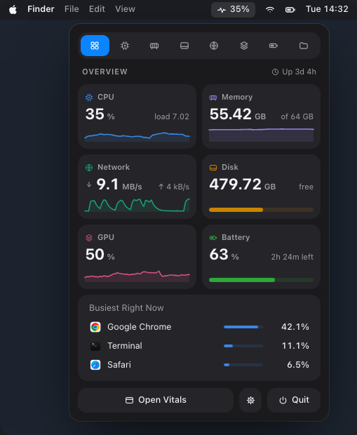 |
| Graph | A tiny history of that number. | 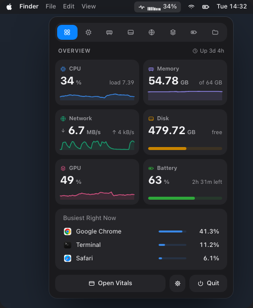 |
| Stacked | A few figures at once, such as CPU and memory. | 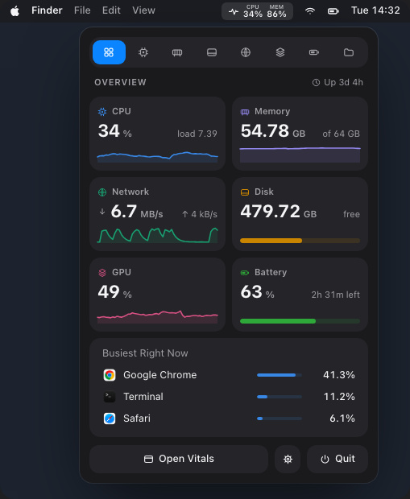 |

The item keeps a stable width so the menu bar does not jump.

The panel behind it is the same app, smaller:

- An icon strip for Overview, CPU, Memory, Disk, Network, GPU, Battery, and Projects.
- Uptime.
- Every metric on one screen, each with a short chart.
- Busiest apps right now.
- **Open Pramana**, which opens the main window on the tab you were looking at, and closes the panel.
- Settings, and Quit.

## Also included

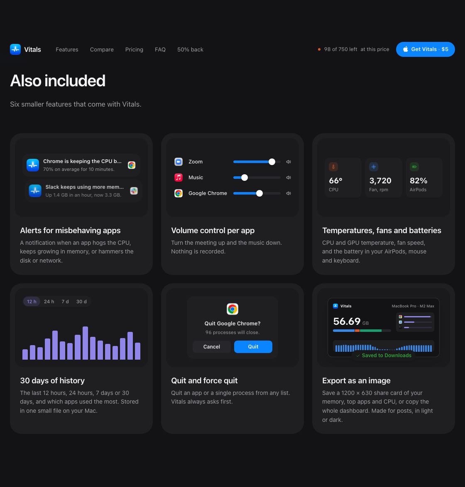

### Alerts

A notification when an app keeps the CPU busy, keeps growing in memory, or hammers the disk or network. The notification names the app and the figure ("70% on average for 10 minutes", "up 1.4 GB in an hour"). Pramana never quits an app because of an alert.

### History

The last 12 hours, 24 hours, 7 days, or 30 days, for every metric, and which apps used the most. Stored in one small file on the Mac. With the window closed, Pramana samples about every five seconds. It samples faster only while the window or the panel is open.

### Volume

A slider per app that is playing sound. Nothing is recorded.

### Temperatures, fans, and other batteries

CPU and GPU temperature, fan speed, and the battery level of AirPods, a mouse, and a keyboard when those devices report one. Temperature follows the Celsius or Fahrenheit setting.

### Quit and force quit

From any app row, any process inside it, or a project. Pramana always asks first. Quit lets the app close itself. Force Quit ends it immediately. The confirmation says what will close ("96 processes will close").

### Export

Copy or save a picture of the Mac: a 1200 × 630 card of memory, the top apps, and CPU, or the whole dashboard. Light or dark.

## Settings

- Show in Dock.
- Celsius or Fahrenheit.
- Network speed in bytes or bits.
- CPU as a share of one core, or of the whole Mac.
- Menu-bar shape, and which metrics it shows.
- Which alerts are on, and how long an app has to misbehave before one fires.

## Privacy

Apps, history, and project names stay on the Mac. Pramana does not phone home. There is no account.

macOS lets an app read the current user's processes without help. Reading the rest of the system's processes needs a small helper. The helper answers one question, how much those processes are using. It takes no commands, changes nothing, and quits when Pramana quits. Pramana works without it. The user's own apps are enough for the everyday question.

## Out of this product

- A license, a price, or an account.
- Sampling a process, spindumps, or the other specialist tools Activity Monitor keeps.
- Watching another machine.
- Cleaning disks, uninstalling apps, or freeing memory on its own.

## When we build it

The spec above is the whole product. The first running version should be, in order:

1. The window and the menu bar, with live CPU and memory, processes already grouped into apps.
2. Disk, network, and battery.
3. Projects, and quit or stop, always after a confirmation.
4. GPU, power, temperatures, and fans.
5. History and alerts.
6. The volume mixer, and export.
