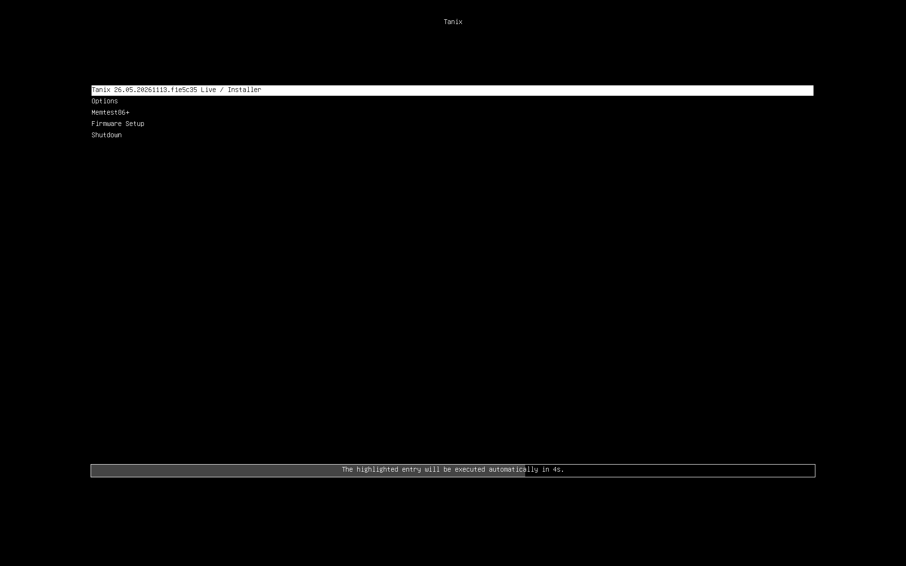
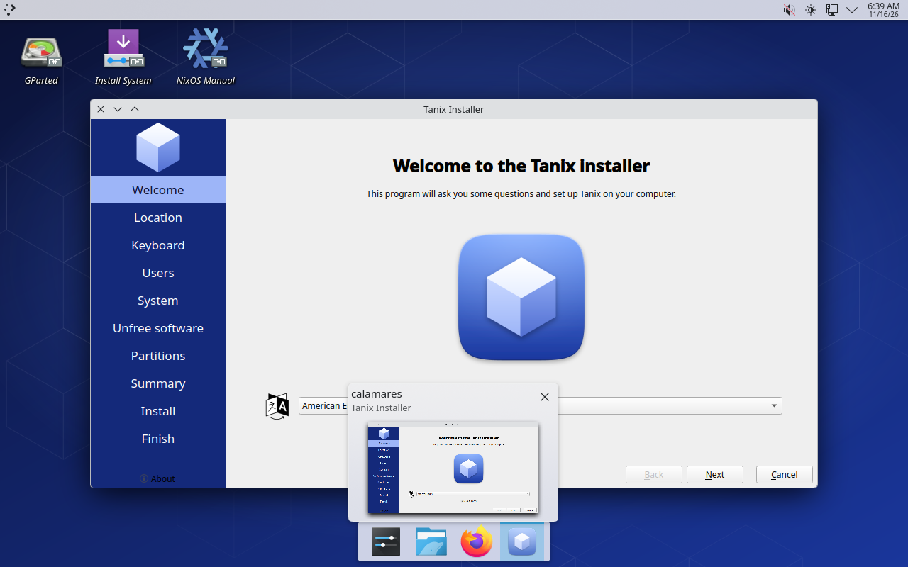

# Tanix branding

## Where the branding shows up

| Place | What | Defined in |
| --- | --- | --- |
| `/etc/os-release` | `NAME=Tanix`, `ID=tanix`, `ID_LIKE=nixos`, `LOGO=tanix` | `modules/tanix/default.nix` |
| Hostname | Defaults to `tanix` | follows the ID above; the installer also defaults to it |
| ISO file and volume | `tanix-<version>-<arch>.iso`, volume label `TANIX_LIVE` | `modules/iso.nix` |
| ISO boot menu | Classic look: white text on black, title "Tanix", entry "Tanix ... Live / Installer" | `modules/iso.nix` (`bootMenuTheme`) |
| Boot splash (Plymouth) | Tanix cube in place of the NixOS logo | `modules/tanix/default.nix`, `assets/tanix-mark.svg` |
| Installed system boot menu | Entries named "Tanix" | follows the name above |
| System icon | An icon named `tanix`, used by "About this system" dialogs | `assets/tanix-logo.svg` |
| Installer | Window title, sidebar colours and logo, welcome page, slideshow | `installer/branding/tanix/` |
| Wallpapers | Dark and light, plus a red version of the dark one for the Security Edition (made at build time by swapping colours) | `assets/wallpapers/`, `default.nix` |
| KDE login and lock screens | The chosen Tanix wallpaper | `modules/tanix/plasma.nix` |
| KDE accent colour | Tanix blue; red on the Security Edition | `modules/tanix/plasma.nix`, `tanix.branding.accentColor` |
| KDE app icons | Two Tanix icon themes installed: **Tanix Minimal 3D** (default) and **Tanix Minimal** (flat). They draw the everyday apps (Dolphin, Konsole, Kate, Firefox, Discover, System Settings, Gwenview, Okular, Spectacle, KCalc); every other icon falls back to Breeze. Applied once per user at first Plasma login (Plasma's Breeze defaults override `/etc/xdg`). Switch in System Settings > Colours & Themes > Icons | `assets/icons/`, `modules/tanix/plasma.nix`, `tanix.desktop.iconTheme` |
| Hyprland | Border, bar, lock screen and notification colours | `modules/tanix/assets/hyprland/` |
| Live user | Named `tanix`; no NixOS manual icon on the desktop | `modules/iso.nix` |
| KDE Plasma layout | Menu bar on top, floating dock at the bottom, window buttons on the left | `modules/tanix/default.nix` (`plasmaLayoutScript`) |

All paths in the right-hand column that start with `assets/` are inside `modules/tanix/`.

The live session with the Tanix KDE layout and the installer:

## The branding module

`modules/tanix/` is one NixOS module plus its `assets/` folder. It is used twice:

- by the ISO, so the live session is branded, and
- by every installed system: the installer copies the folder to `/etc/nixos/tanix` and the generated configuration imports it.

Because it is copied onto other machines, it must not depend on anything outside its own folder except nixpkgs.

Options:

| Option | Default | Meaning |
| --- | --- | --- |
| `tanix.branding.enable` | `true` | Turn all Tanix branding off with `false`. |
| `tanix.branding.wallpaper` | `"dark"` | `"dark"`, `"light"` or `"security"`: the default for desktops that take one image, and for the login and lock screens. |
| `tanix.branding.accentColor` | `"26,55,158"` | Plasma accent colour as R,G,B. |
| `tanix.desktop.macLayout` | `true` | On KDE Plasma, give new users the Tanix layout. `false` keeps Plasma's stock single bottom panel. |
| `tanix.security.enable` | `false` | The Security Edition (set by the installer's Security Edition choice). |
| `tanix.security.categories.<name>.packages` | empty | The tools, per Kali-style category. See [features.md](features.md). |

## Wallpapers

The wallpapers are SVG files, rendered to 3840x2160 PNG during the build. They are installed in three forms so each desktop's own wallpaper picker lists them:

- `share/backgrounds/tanix/tanix-dark.png` and `tanix-light.png`
- `share/wallpapers/Tanix-dark` and `Tanix-light` (KDE)
- `share/gnome-background-properties/tanix.xml` (GNOME; switches between light and dark with the system style)

How the default is set, per desktop:

| Desktop | Mechanism | Status |
| --- | --- | --- |
| KDE Plasma | A small autostart script runs `plasma-apply-wallpaperimage` once per user at first login. Later changes by the user are kept. | Seen working in the live session |
| Hyprland | A `swaybg` user service started with the graphical session | Not yet seen on screen |

An earlier version also set the wallpaper for GNOME, Cinnamon, MATE, Sway and Niri. Those desktops were removed from the installer, and that untested code went with them.

## The KDE Plasma layout

The Tanix KDE desktop is arranged like macOS, using only parts that ship with Plasma (no extra themes, widgets or downloads):

- **Top bar** (28 px): application launcher, the active window's menu (global menu), a spacer, system tray, clock.
- **Dock** (bottom, floating, centred, as wide as its icons): the icons-only task manager. It moves out of the way of windows.
- **Window buttons on the left**, in the order close, minimise, maximise.

How it is applied: the same once-per-user autostart script that sets the wallpaper also runs `plasmaLayoutScript` through Plasma's desktop scripting interface. It removes the stock panel and creates the two above. Because it runs once, anything the user changes afterwards stays changed. The window buttons are a system default in `/etc/xdg/kwinrc`.

Seen working in the live session (2026-11-16). Colours and window style are Plasma's stock Breeze (app icons are Tanix's own, see the table above); making those more macOS-like without external themes is limited to what System Settings offers.

## Changing things

- **New wallpaper:** replace or edit the SVG files in `modules/tanix/assets/wallpapers/`. Keep the two file names, or update the loop in `default.nix`. Avoid text in wallpapers: the build has no fonts available at that step.
- **New logo:** replace `assets/tanix-logo.svg` (full icon with background) and `assets/tanix-mark.svg` (cube alone, transparent background). `icon/AppIcon.svg` is the original the logo was copied from.
- **App icons:** edit the SVGs in `assets/icons/tanix-minimal-3d/` or `assets/icons/tanix-minimal/` (`scalable/apps/`, one file per icon name; KDE ids like `org.kde.dolphin.svg` are symlinks). To add an app, add its icon name there. To change the default theme: `tanix.desktop.iconTheme = "tanix-minimal";` (or `"breeze"`) in `/etc/nixos/configuration.nix`. Users who picked a theme in System Settings keep their choice.
- **KDE layout:** `plasmaLayoutScript` in `modules/tanix/default.nix`. To see a change on an account that already logged in, delete `~/.local/state/tanix/plasma-setup-done` and log in again.
- **Installer colours:** `style:` in `installer/branding/tanix/branding.desc`.
- **Boot menu:** the `bootMenuTheme` block in `modules/iso.nix`. It is a small GRUB theme: colours, title and menu position are in its `theme.txt`. It was made plain white on black on request (2026-11-16); an earlier version used a Tanix background image.

Colours in use: `#0A1030` (darkest), `#14297A`, `#1A379E`, `#2B4FC0`, `#6A9BFF`, `#9DB5F8`, `#C9D8FF`.

## Not branded yet

- The SDDM login screen on Hyprland systems (stock theme; the Tanix background needs Plasma's Breeze theme). The live session's login manager is never shown (it logs in by itself).
- The installer's links (release notes, support) point at nixos.org, because Tanix has no site of its own.
