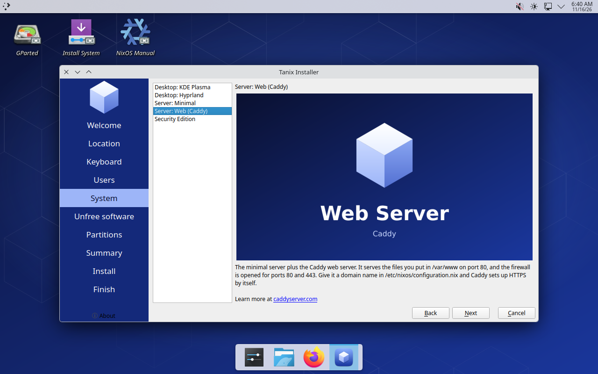
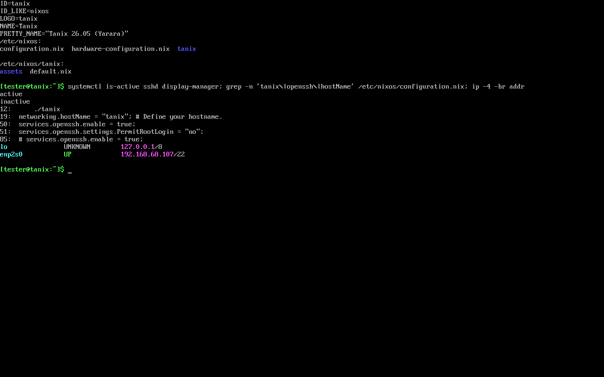
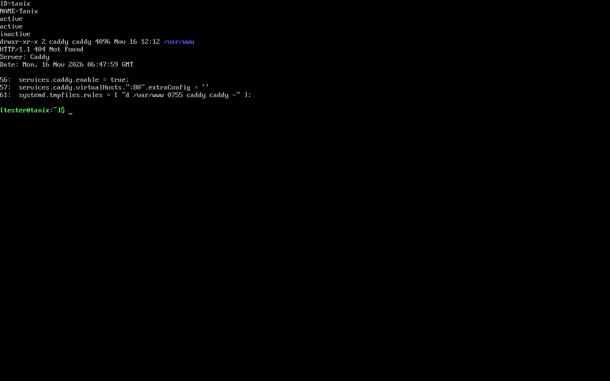

# The Tanix ISO and installer

## One ISO, two uses

The ISO boots into a **live session**: a full KDE Plasma desktop running from the ISO, with nothing written to disk. From that session the **installer** (Calamares) starts automatically, and there is an "Install System" icon on the desktop to reopen it. Close the installer window to just use the live system.

This is the same arrangement the official NixOS graphical ISO uses. Tanix starts from that ISO's definition and changes the installer and the branding.

The live user is `tanix` with an empty password and passwordless `sudo`.

## Installer pages

Welcome, Location, Keyboard, Users, **System**, Unfree software, Partitions, Summary, Install, Finish.

The System page is where the kind of installation is chosen:

| Choice | What is installed |
| --- | --- |
| Desktop: KDE Plasma (default) | Plasma 6 with the Tanix layout (menu bar on top, dock at the bottom, window buttons on the left), Tanix wallpaper on desktop, login and lock screens, Tanix accent colour, extra apps, Flatpak with Flathub |
| Desktop: Hyprland | Hyprland started through UWSM, SDDM, kitty, hyprlauncher, Dolphin, plus the Tanix setup: config, Waybar, hyprlock, hypridle, mako, clipboard history, screenshots |
| Server: Minimal | No desktop and no graphical programs. SSH with keys only, fail2ban, nightly upgrades. |
| Server: Web (Caddy) | Server: Minimal plus Caddy serving `/var/www` (welcome page included) on port 80; ports 80 and 443 open; `tanix-web-setup` sets the domain. |
| Server: Containers (Podman) | Server: Minimal plus Podman, a docker-compatible command and podman-compose. |
| Server: Database (PostgreSQL) | Server: Minimal plus PostgreSQL, local connections only. |
| Security Edition | A minimal, hardened KDE Plasma with a red look, and the security tool categories. **The tools are empty for now**: see `modules/tanix/security.nix`. |

Every choice also gets the Tanix base (tools, zsh, clean-up, zram, flakes). Details and options: [features.md](features.md).



The two desktop choices and the Security Edition also get sound (PipeWire) and Firefox, and the two desktops get printing. The server choices get none of those.

The NixOS installer offers ten more desktops (GNOME, Xfce and others). Tanix removed them on request (2026-11-16).

**Installing needs internet.** Only the live session's own software is on the ISO. The chosen desktop is downloaded while installing.

**Name servers.** The live session asks Cloudflare (`1.1.1.1`) and Quad9 (`9.9.9.9`) first, then the name server the network hands out. This is because some internet providers' own name servers fail or give wrong answers, which breaks the browser and the installer's downloads. It is set in `modules/iso.nix` and applies to the live session only; an installed system uses the network's name servers, as plain NixOS does.

## What the installer writes

On the target disk the installer creates:

- `/etc/nixos/configuration.nix`: generated from the answers. It contains the lines for the chosen desktop or server profile, and `tanix.autoUpgrade.enable` (`true` for servers, `false` for desktops).
- `/etc/nixos/hardware-configuration.nix`: detected hardware.
- `/etc/nixos/tanix/`: a copy of the [branding module](branding.md). `configuration.nix` imports it, so the installed system is called Tanix and has the Tanix wallpapers.

After installation the system is changed the usual NixOS way: edit `/etc/nixos/configuration.nix`, then `sudo nixos-rebuild switch`. Switching desktop later means replacing the desktop lines in that file.

## How it is put together

Everything is in `installer/`, applied as an overlay on the nixpkgs package `calamares-nixos-extensions` (see `installer/default.nix`):

| File | Purpose |
| --- | --- |
| `patches/tanix-installer.patch` | Changes to the installer's Python module: the lines for Hyprland, the two server choices and the Security Edition; which choices count as servers; the `./tanix` import; copying `/etc/tanix` to the target; "Tanix" in progress messages and the default hostname. |
| `config/packagechooser.conf` | The System page: names, descriptions, pictures, default. |
| `branding/tanix/branding.desc` | Installer name, sidebar colours, logo. |
| `branding/tanix/show.qml` | The slideshow shown during installation. |

The KDE picture comes from the upstream package. The other choices have no upstream picture, so `installer/default.nix` draws a simple name tile for each.

**No recompiling.** The installer program (Calamares) has the location of these files built in. `installer/default.nix` takes the prebuilt program from the NixOS binary cache and rewrites that one location in it (`replaceDependencies`), so a change in `installer/` costs seconds. An earlier version rebuilt Calamares from source on every change, about 10 minutes at full CPU.

## Adding or changing a choice

1. Add an item to `installer/config/packagechooser.conf`. The `id` is what the installer module receives.
2. Add the matching lines to the installer module (the next section explains how to edit the patch): a `cfg<id>` text block with the NixOS options, and an `elif` branch that appends it.
3. If the choice has no desktop, add its id to `TANIX_SERVER_IDS` in the patch and to `SERVER_IDS` in `scripts/check_desktops.py`. Server choices get no sound, printing or Firefox, and log in on the console.
4. Add a picture for it to `tiles` in `installer/default.nix`.
5. Run `./scripts/check-desktops.sh <id>`, then rebuild the ISO.

The empty id (`""`) is Server: Minimal, because that is the id the upstream installer uses for "no desktop".

To change what a choice installs without touching the installer, prefer the Tanix module: the Security Edition's tools, for example, live in `modules/tanix/security.nix`, not in the patch.

## Regenerating the patch

The patch is a diff against one file of the pinned nixpkgs revision: `pkgs/by-name/ca/calamares-nixos-extensions/src/modules/nixos/main.py`. To change it, or to redo it after upstream changed the file:

```sh
# inside the builder, in an empty work folder
SRC=$(nix --extra-experimental-features 'nix-command flakes' eval --raw --inputs-from path:/path/to/apps/tanix nixpkgs#path)/pkgs/by-name/ca/calamares-nixos-extensions/src
mkdir -p a/modules/nixos b/modules/nixos
cp $SRC/modules/nixos/main.py a/modules/nixos/
cp $SRC/modules/nixos/main.py b/modules/nixos/
chmod -R u+w a b
patch -p1 -d b < /path/to/apps/tanix/installer/patches/tanix-installer.patch   # may need fixing by hand
# edit b/modules/nixos/main.py
diff -u a/modules/nixos/main.py b/modules/nixos/main.py > /path/to/apps/tanix/installer/patches/tanix-installer.patch
```

## What has been tested

On 2026-11-16, in VMware Fusion on an Apple Silicon Mac:

- The ISO boots; the boot menu, live session, wallpaper, KDE layout and installer branding show as intended.
- A full **Server: Minimal** install completed ("All done"). The installed system booted from its own disk, the user created in the installer could log in, `/etc/os-release` said Tanix, `/etc/nixos/tanix` was present and imported, `sshd` was active and no display manager was running.



- A full **Server: Web (Caddy)** install completed. After booting from disk, `caddy` and `sshd` were active, `/var/www` existed and was owned by `caddy`, and `curl -I http://localhost` answered with `Server: Caddy` (a 404, because `/var/www` starts empty).



Checked by evaluation only (`./scripts/check-desktops.sh`), not yet by installing: **KDE Plasma, Hyprland and Security Edition**. In particular the Hyprland wallpaper service has not been seen running, and the KDE layout has been seen in the live session but not on an installed system.

One problem seen and avoided: with the ISO attached to the VM as a CD, the live system got read errors from the CD partway through an install and crashed, leaving a system with no password set. Attached as a disk, which is how a USB stick appears, the install completed. `scripts/fusion-vm.sh` attaches it as a disk. The cause on the CD path is not understood.
