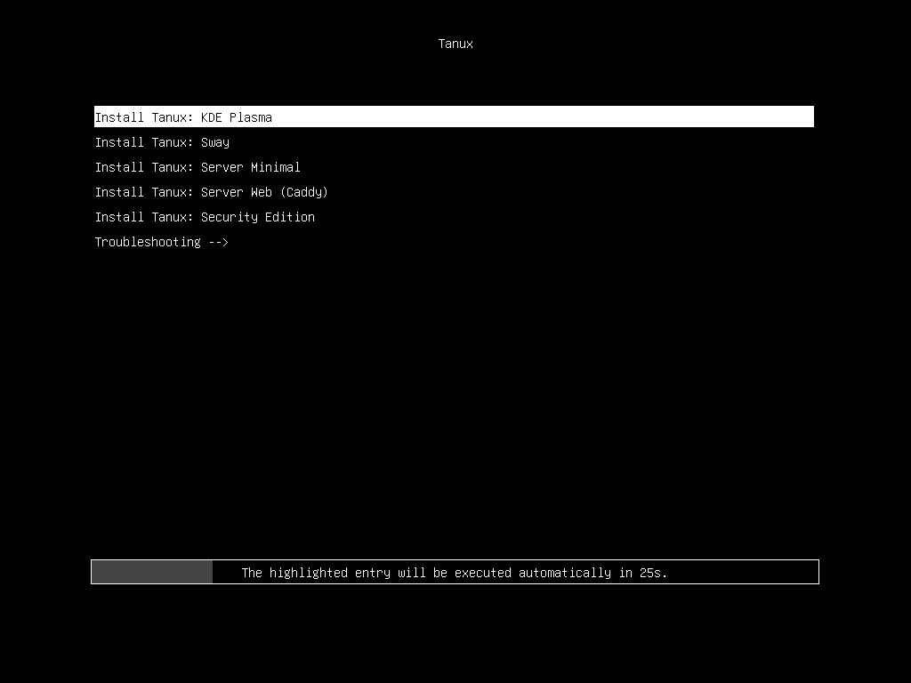
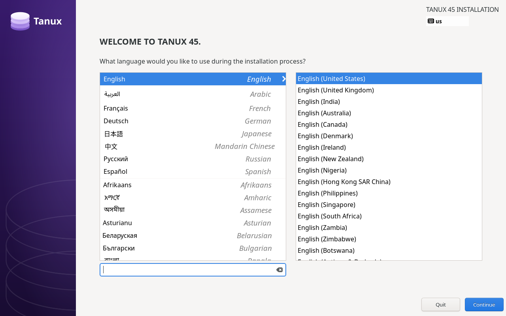
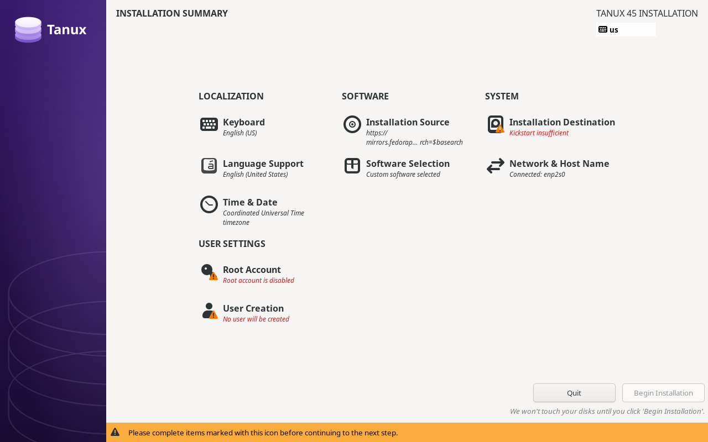
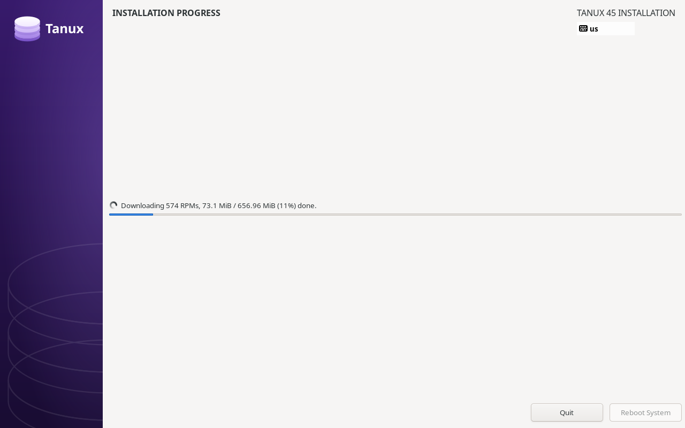

# The Tanux ISO and installer

## One netinstall ISO, five editions

Tanux uses a **Fedora Everything–style netinstall ISO** (`build/tanux-45-aarch64.iso`, ~1.3 GB). Instead of carrying a ~3 GB live KDE desktop that has to be copied and stripped for servers or alternate desktops, it boots straight into Anaconda and installs only the selected edition's exact RPMs from Fedora 45 mirrors plus the embedded `/tanux-repo` on the ISO.

## Boot menu choices

At boot, the white-on-black GRUB menu offers:

| Entry | Kickstart | What is installed |
| --- | --- | --- |
| `Install Tanux: KDE Plasma` (default) | `/ks/kde.ks` | `@kde-desktop-environment`, `kate`, `firefox`, `tanux-release-kde`, `tanux-logos`, `tanux-desktop-kde` (macOS-style layout + wallpapers), `plasmalogin` enabled, `graphical.target` |
| `Install Tanux: Sway` | `/ks/sway.ks` | `@sway-desktop-environment`, `kitty`, `dolphin`, `tanux-release-sway`, `tanux-logos`, `tanux-desktop-sway` (Tanux wallpaper + `kitty` default), `sddm` enabled, `graphical.target` |
| `Install Tanux: Server Minimal` | `/ks/server-minimal.ks` | `@core`, `@standard`, `openssh-server`, `NetworkManager`, `firewalld` (`ssh` open), `PermitRootLogin no`, `tanux-release-server`, `tanux-logos`, `multi-user.target` |
| `Install Tanux: Server Web (Caddy)` | `/ks/server-web.ks` | Server Minimal plus `tanux-release-server-web` and `tanux-server-web` (`caddy` serving `/var/www` on `:80`, `caddy.service` enabled, HTTP/HTTPS open in firewalld) |
| `Install Tanux: Security Edition` | `/ks/security.ks` | KDE Plasma plus `tanux-release-security` and `tanux-security` (whose `Requires:` tool list is intentionally empty for now) |

Every Kickstart excludes `fedora-release*`, `fedora-logos*`, `generic-release*`, and `generic-logos*` so `tanux-release-*` and `tanux-logos` replace Fedora branding cleanly.

**Installing needs internet.** Only the installer stage2 and `/tanux-repo` (Tanux RPMs) are on the ISO; Fedora 45 packages are downloaded during installation.

## Interactive installer flow

Each GRUB entry passes `inst.stage2=hd:LABEL=TANUX_45 inst.ks=hd:LABEL=TANUX_45:/ks/<id>.ks`. Because the Kickstarts intentionally omit `autopart`, `clearpart`, `user`, `rootpw`, `lang`, and `reboot`, Anaconda opens interactively:

1. **Welcome** ("WELCOME TO TANUX 45."): choose installer language.
2. **Installation Summary**: `Keyboard`, `Language Support`, `Time & Date`, `Installation Source`, `Software Selection` (`Custom software selected`), and `Network & Host Name` (`Connected: enp2s0`, hostname `tanux`) come pre-configured without warnings. Only **Installation Destination** and **User Creation** (or Root Account) require input before clicking **Begin Installation**.

Note: Avoid clicking a different Base Environment inside the **Software Selection** spoke, as doing so replaces the Kickstart's custom `%packages` list.

## How it is put together

| File | Purpose |
| --- | --- |
| `installer/editions.py` | Single source of truth for the five editions (`id`, `grub_label`, `packages`, `services`, `firewall_services`, `post`) |
| `installer/build_configs.py` | Renders `/ks/*.ks`, `/EFI/BOOT/grub.cfg`, and GRUB theme PNG tiles from `editions.py` |
| `installer/grub/theme.txt` | Classic white-on-black GRUB theme layout |
| `installer/anaconda/` | GTK CSS (`fedora.css`) and SVG sources rendered into `/images/product.img` |

## Adding or changing an edition

1. Edit `EDITIONS` in `installer/editions.py` (or edit `rpm/tanux-security.spec` if only adding tools to Security Edition).
2. Run `./scripts/check-kickstarts.sh` to validate Kickstart syntax (`ksvalidator`) and DNF5 dependency resolution against Fedora 45.
3. Run `./scripts/build-iso.sh` to repack `build/tanux-45-aarch64.iso`.

## What has been tested

Verified on **2026-11-17**:

- `./scripts/build-rpms.sh` built all 14 `noarch` `.fc45` RPMs (`build/repo/`).
- `./scripts/check-kickstarts.sh` validated all 5 Kickstarts with `ksvalidator -v F45` and resolved all 5 DNF5 transactions cleanly (`kde`: 2205 packages, `sway`: 1456, `server-minimal`: 535, `server-web`: 538, `security`: 2206).
- `build/tanux-45-aarch64.iso` (1.3 GB) booted in VMware Fusion (`arm64`): white-on-black GRUB menu, branded Anaconda Welcome screen, Installation Summary hub with pre-configured network/source/software/keyboard/timezone, disk selection, user creation, and active RPM download (`73.1 MiB / 656.96 MiB (11%)` on `Server: Web (Caddy)`) were all observed before testing was paused (`vmrun pause`).

Not yet verified:

- Completion of the `Server: Web (Caddy)` install and booting the installed VM disk (`./scripts/fusion-vm.sh disk`).
- Full installs of `KDE Plasma`, `Sway`, `Server: Minimal`, and `Security Edition` (in particular, seeing `tanux-desktop-kde` and `tanux-desktop-sway` live on first desktop login).
- `x86_64` ISO builds and physical hardware.
