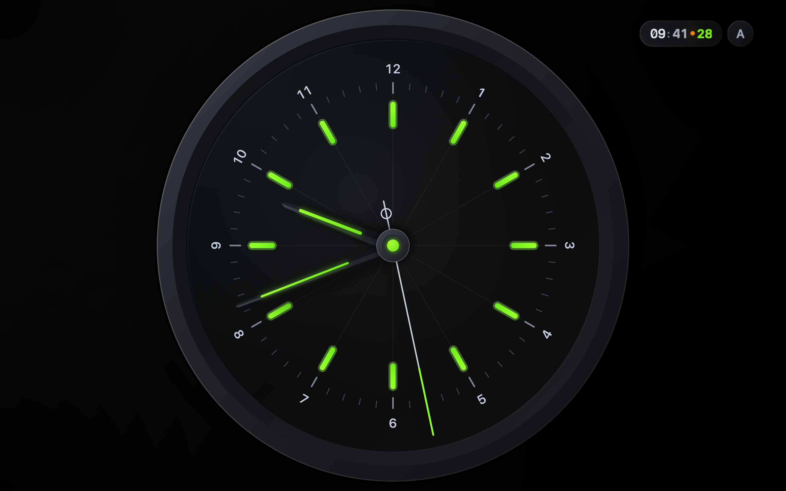

# timed-macos-scr

An aesthetic, VisionOS-inspired analog clock screen saver for macOS, meticulously crafted after the iconic clock design concept by [@tweetbylokki on X/Twitter](https://x.com/tweetbylokki).

Engineered strictly as a native macOS Screen Saver (`.saver` bundle) conforming to Apple's official `ScreenSaverView` framework, featuring a pure **Obsidian Dark** aesthetic, dynamic full-screen vector scaling, and real-time live clock animation with a silky 60 FPS sweeping second hand.



---

## Features

- **Version**: `0.007`
- **Strictly a macOS Screen Saver**:
  - Compliant with Apple's official `ScreenSaver` framework (`ScreenSaverView` lifecycle with `init(frame:isPreview:)`, `startAnimation()`, `stopAnimation()`, and 60 FPS `animateOneFrame()`).
  - Pure native `.saver` bundle with zero external runtime dependencies.
- **Full-Screen 3D Realistic Watch Face**:
  - The watch itself is **full screen**, occupying **97% of the display height** with zero awkward pillarbox boundaries.
  - Multi-layered **brushed titanium bezel** with directional 135° lighting (specular sheen on top-left, deep shadow on bottom-right).
  - Stepped **3D conical rehaut** (chapter ring wall) casting an ambient occlusion shadow onto the dial plate.
  - **Curved sapphire crystal reflection sheen** with seamless optical anti-reflective coating and specular rim highlight.
- **Pure Symmetrical Obsidian Dial**:
  - Pristine, uninterrupted dial face with radial lighting and complete 360° horological balance across all 12 hours.
- **Concentric Dial Architecture & Curvature-Aligned Swiss Typography**:
  - Organized into 4 concentric tiers: radial spoke hairlines (`0.10`–`0.73`), Super-LumiNova glowing batons (`0.57`–`0.70`), precision 60-minute chapter ring (`0.74`–`0.79`), and curvature-aligned numerals (`0.86`).
  - Swiss watch typography in **SF Pro Display Medium with tabular digits**, curved tangent to the chapter ring with generous breathing margins.
- **3D Faceted Hands & Multi-Level Elevation Shadows**:
  - **Faceted Hour & Minute Hands**: Split longitudinal bevels (illuminated flank vs shadow flank) with recessed Super-LumiNova neon lime center channels.
  - **Layered 3D Elevation Shadows**: Hour hand casts a realistic shadow onto the dial; minute hand sits higher and casts a longer shadow; live sweeping second hand floats above both.
  - **Live Sweeping Seconds Hand**: Ultra-thin titanium needle with a skeletonized open-ring counterweight and glowing neon lime tip gliding smoothly at 60 FPS.
  - **Multi-Tier Center Pinion Cap**: Turned metal base, chamfered polished bevel, and a domed neon lime jewel.
- **Top-Right Floating Digital Clock HUD (Outside the Ring)**:
  - Positioned outside the watch ring at the top-right corner of the display.
  - Dark titanium capsule pill displaying `HH:MM • SS` with internal slashed zero (`0̸`), cool metallic minutes, glowing amber jewel (`•`), live neon lime seconds (`#8cf026`), and companion circular AM/PM dish.

---

## Usage & Installation

### Requirements
- macOS 14.0 (Sonoma), macOS 15.0 (Sequoia), macOS 27 or later.
- Apple Silicon (M1/M2/M3/M4) or Intel Mac.
- Swift 6.0+ / Xcode Command Line Tools.

### Quick Commands

```bash
# 1. Build the release screensaver bundle (dist/TimedClock.saver)
./scripts/build.sh

# 2. Test live in full-screen without installing (Press any key or click to exit)
./scripts/preview.sh

# 3. Install into macOS System Settings > Screen Savers
./scripts/install.sh
```

---

## Project Structure

```text
timed-macos-scr/
├── Package.swift               # Swift Package manifest (TimedClockCore)
├── Sources/
│   ├── TimedClockCore/         # Scalable vector views, dark theme tokens, and live time model
│   │   ├── TimedTheme.swift    # Dark color tokens and aesthetic constants
│   │   ├── TimedClockModel.swift # 60 FPS high-precision time publisher (hours, minutes, seconds)
│   │   ├── TimedClockCardView.swift # Full-screen analog dial, sculpted hands, sweeping second hand, pill
│   │   └── TimedClockMainView.swift # Full-screen layout orchestrator with edge-to-edge backdrop
│   └── TimedClockSaver/        # Native Apple ScreenSaverView host
│       └── TimedClockScreenSaverView.swift
├── Resources/                  # High-resolution screenshot render
│   └── preview_dark.png
├── scripts/
│   ├── build.sh                # Compiles TimedClock.saver Mach-O bundle
│   ├── install.sh              # 1-click installer into ~/Library/Screen Savers/
│   ├── preview.sh              # Non-intrusive full-screen live preview
│   ├── preview_runner.swift    # Ephemeral test runner (dismiss on any key)
│   └── render_preview.swift    # High-resolution vector renderer for documentation
└── README.md
```

---

## Credits

Clock design concept inspired by **[@tweetbylokki](https://x.com/tweetbylokki)** on X (Twitter).
Engineered and packaged for macOS by **Antigravity**.
