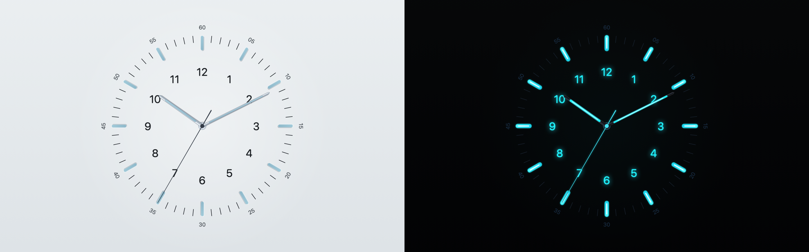

# timed-macos-scr

An aesthetic, borderless minimalist **Bauhaus Horological Clock** screen saver for macOS, faithfully replicating the acclaimed clock design by [Atilla Taşkıran (bauhausclock.com)](https://bauhausclock.com).

Engineered strictly as a native macOS Screen Saver (`.saver` bundle) conforming to Apple's official `ScreenSaverView` framework, featuring adaptive **Glacier White Light Mode** and **Swiss BGW9 Electric Cyan Dark Mode**, dynamic full-screen vector geometry, and real-time live clock animation with a continuous 60 FPS sweeping second hand.



---

## Features

- **Version**: `0.010`
- **Eight faces** (pick one in System Settings › Screen Saver › Options…). Every face fills the whole screen and sizes itself to whichever display it runs on. Each 3D face has its own layout, not just its own colors:
  - **Bauhaus** (original, follows system light/dark): described below.
  - **Bauhaus Lume (3D)**: the original layout (1–12, pill batons, 05–55 ring, pencil hands) with 3D metal and glowing cyan lume on black.
  - **Obsidian (dress)**: black sunburst, applied polished batons, sword hands, date at 3.
  - **Pilot**: matte black, large printed numerals, triangle and two dots at 12, heat-blued sword hands.
  - **Chronograph**: charcoal sunburst, three recessed sub-dials with concentric grooves (running seconds at 9, 30-minute counter at 3, 12-hour counter at 6), tachymeter scale, 1/5-second track, stick hands, red center seconds.
  - **Lunar (moon phase)**: blue guilloché, Roman numerals, railroad track, open-ring (Breguet-style) hands, and a moon window at 6 showing the real current moon phase.
  - **Meridian (GMT)**: two-tone day/night 24-hour ring, arrowhead markers, an orange 24-hour hand showing UTC, date.
  - **Abyss (diver)**: matte black, lume dots, triangle at 12, orange seconds with lume lollipop, date.
- **3D lighting on the dark faces**: one top-left light shades everything. Hand and marker facets brighten and darken as they turn, and cast shadows always fall the same way (higher hands cast longer shadows). Only the hands layer redraws each frame.
- **Strictly a Native macOS Screen Saver**:
  - Compliant with Apple's official `ScreenSaver` framework (`ScreenSaverView` lifecycle with `init(frame:isPreview:)`, `startAnimation()`, `stopAnimation()`, and 60 FPS `animateOneFrame()`).
  - Pure native `.saver` bundle with zero companion applications, helper daemons, or external runtime dependencies.
- **Adaptive Day & Night Horological Dial**:
  - **Light Mode (Glacier Ceramic White)**: Soothing off-white ceramic canvas (`#EAEFF2`), tactile 3D embossed ice-cyan pill batons with beveled highlights, crisp graphite Bauhaus typography, and brushed titanium hands with central lume channels.
  - **Dark Mode (Swiss BGW9 Super-LumiNova)**: Deep obsidian OLED pitch black (`#050709`), radiant electric cyan lume (`#00F2FF`) with ambient bloom on numerals, batons, and hands, alongside muted deep-slate minute ticks.
  - Automatically adapts to your macOS system appearance (`Dark Mode` / `Light Mode`).
- **4 Concentric Horological Tiers**:
  1. **Tier 1: Inner Upright Bauhaus Hour Numerals (1–12)**: Upright, centered numerals in rounded Bauhaus typography with circular bowls and balanced geometry.
  2. **Tier 2: 3D Embossed Hour Batons (12 Pills)**: Radial capsule batons at each hour mark, shaded with realistic directional lighting (white highlight on top-left, drop shadow on bottom-right) in light mode, and high-intensity luminous core with bloom in dark mode.
  3. **Tier 3: Precision Minute Track**: 4 thin radial tick marks neatly recessed between each hour baton.
  4. **Tier 4: Outer 5-Minute Numerals (60, 05, 10, ... 55)**: Tangentially aligned 5-minute numerals following the dial circumference with upright readability.
- **Sculpted Hands & Silky 60 FPS Sweep**:
  - **Hour & Minute Hands**: Tapered pencil shape with split 3D longitudinal chamfers (light flank vs shadow flank) and recessed luminescent central channels.
  - **Sweeping Second Hand**: Ultra-fine needle gliding continuously at 60 FPS, extending through the outer 5-minute ring with a rounded counterweight tail.
  - **Center Pinion**: Turned metal collet washer with an open dark center aperture and second hand pivot cap.
- **Interactive Full-Screen Preview**:
  - Instant ephemeral preview via `./scripts/preview.sh` (always rebuilds first).
  - `←` / `→` or `1`–`8` switch face. `Space` or `T` toggles Light / Dark on the Bauhaus face.
  - `ESC` or `Q` exits. Other keys and clicks are ignored.

---

## Usage & Installation

### Requirements
- macOS 14.0 (Sonoma), macOS 15.0 (Sequoia), macOS 27 or later.
- Apple Silicon (M1/M2/M3/M4) or Intel Mac.
- Swift 6.0+ / Xcode Command Line Tools.

### Quick Commands

```bash
# 1. Build the release screensaver bundle (dist/TimedClock.saver)
./scripts/build.sh

# 2. Test live in full-screen without installing (arrows switch face, ESC exits)
./scripts/preview.sh

# 3. Install into macOS System Settings > Screen Savers
./scripts/install.sh
```

---

## Project Structure

```text
timed-macos-scr/
├── Package.swift               # Swift Package manifest (TimedClockCore)
├── Sources/
│   ├── TimedClockCore/         # Scalable vector views, themes, and live time model
│   │   ├── TimedTheme.swift    # BauhausDialTheme (Light & Dark color palettes & tokens)
│   │   ├── TimedClockModel.swift # 60 FPS high-precision time publisher (hours, minutes, seconds)
│   │   ├── TimedClockMainView.swift # Full-screen Bauhaus clock orchestrator
│   │   ├── RealisticWatchTheme.swift # 3D dial themes + WatchFace list
│   │   ├── RealisticWatchView.swift # Full-screen 3D dial renderer + face switcher
│   │   └── DialComplications.swift # Pilot, chronograph, moon phase and GMT layouts
│   └── TimedClockSaver/        # Native Apple ScreenSaverView host
│       └── TimedClockScreenSaverView.swift
├── Resources/                  # High-resolution screenshot renders
│   ├── preview_light.png       # Glacier White daylight preview
│   ├── preview_dark.png        # Swiss BGW9 cyan night preview
│   └── preview_duo.png         # Side-by-side comparison preview
├── scripts/
│   ├── build.sh                # Compiles TimedClock.saver Mach-O bundle
│   ├── install.sh              # 1-click installer into ~/Library/Screen Savers/
│   ├── preview.sh              # Non-intrusive full-screen live preview
│   ├── preview_runner.swift    # Ephemeral test runner with Spacebar Light/Dark toggle
│   └── render_preview.swift    # Renders every face to PNG (default Resources/, or a folder argument)
└── README.md
```

---

## Credits

Replication of the **Bauhaus Clock** design by **[Atilla Taşkıran](https://bauhausclock.com)**.
Engineered and packaged natively for macOS by **Antigravity**.
